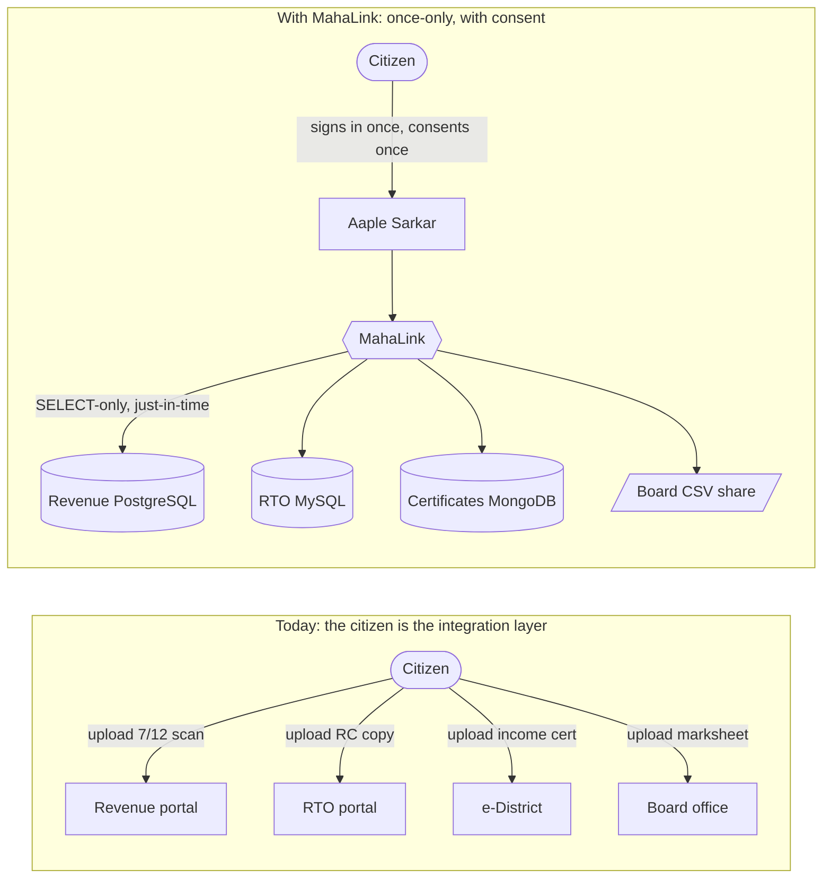
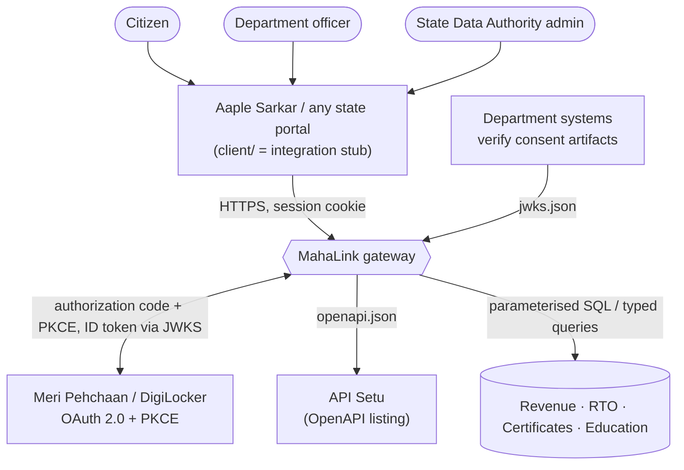
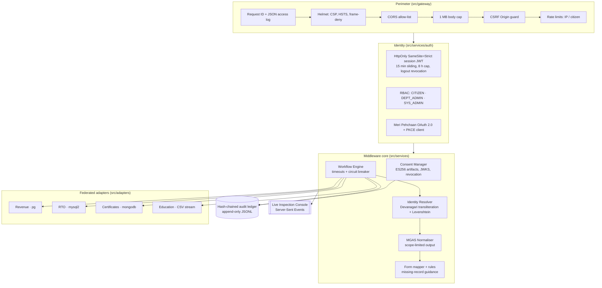
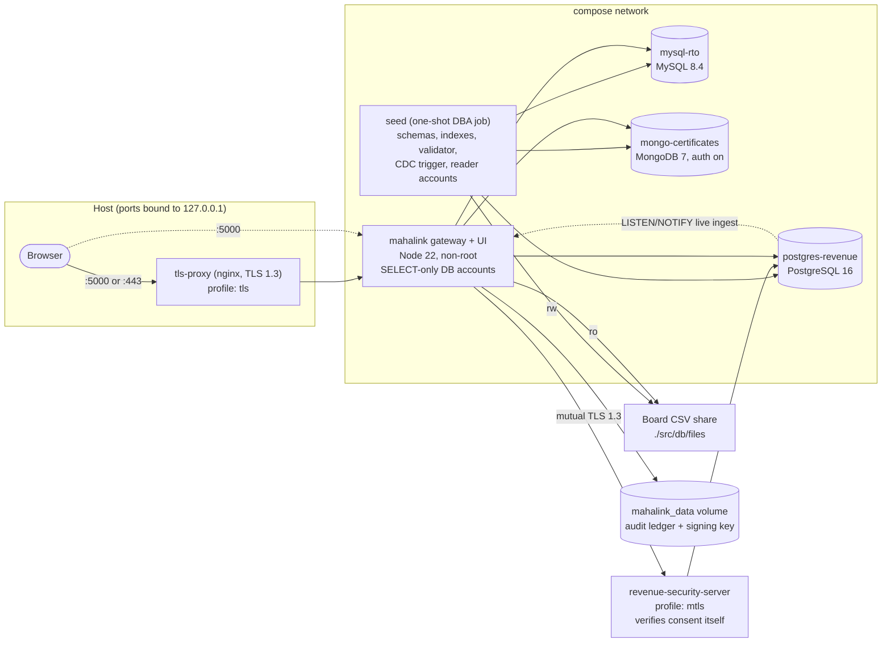
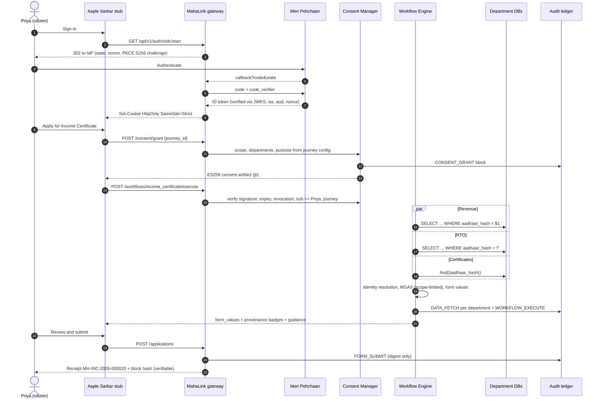
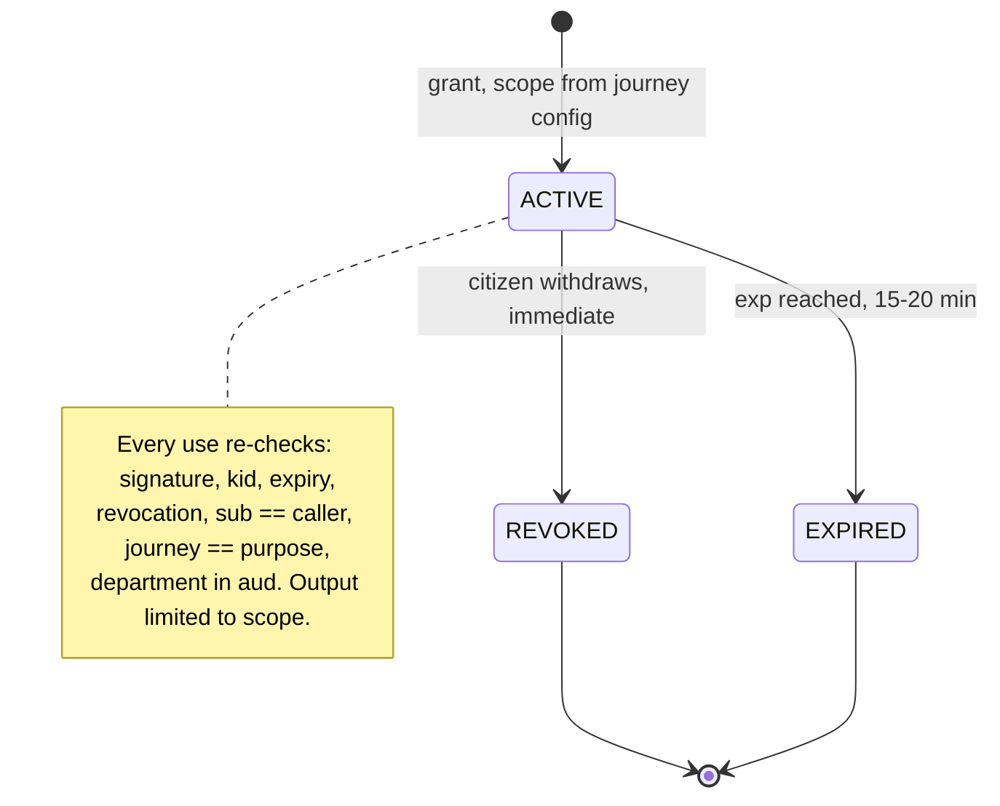
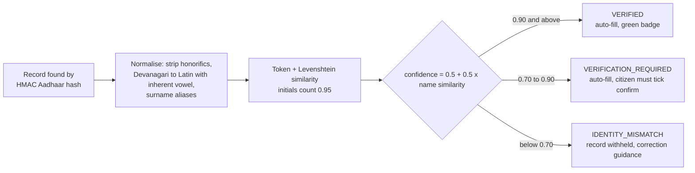
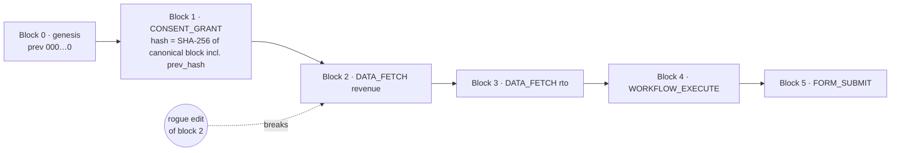
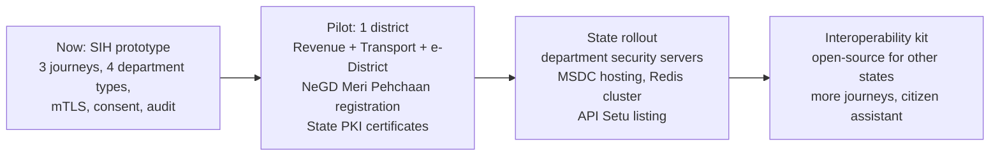

# MahaLink — Maharashtra Federated Interoperability & Consent Middleware

> **Smart India Hackathon 2026 · Problem Statement SIH26129** · Theme: Smart Automation · Category: Software
> Team **INFERNO VI** (SIH2026-158) · Sponsor: Government of Maharashtra (DIT / Maha-IT)
> Architecture references: IndEA 2.0 Integration Reference Model · DEPA consent · X-Road federation · DPDP Act 2023

MahaLink is **middleware software**, not a portal. State portals such as *Aaple Sarkar* call it. It then:
1. authenticates the citizen through **Meri Pehchaan**;
2. asks for **DEPA-style, machine-verifiable consent**;
3. reads the citizen's records **just-in-time** from each department's own database (PostgreSQL, MySQL, MongoDB and a legacy CSV share), without copying them anywhere;
4. reconciles names across Devanagari and English;
5. normalises everything to one schema (MGAS) and returns form-ready values;
6. writes a **tamper-evident, hash-chained audit record** of every access.

The React app in [`client/`](client/) is an *Aaple Sarkar integration stub* that shows the middleware working end to end.

### SIH 2026 at a glance

| | |
|:--|:--|
| **Problem** | SIH26129: system integration and interoperability among government digital platforms, resulting in fragmented service delivery |
| **Theme / category** | Smart Automation · Software |
| **Team** | INFERNO VI (SIH2026-158) |
| **One line** | A federated, consent-first middleware that lets Maharashtra departments share verified citizen data on demand, without a central database |
| **What runs today** | Gateway, Meri Pehchaan OAuth 2.0 + PKCE client, DEPA consent artifacts (ES256 + JWKS), identity resolver (Devanagari ↔ English), MGAS normaliser, hash-chained audit ledger, 4 heterogeneous department adapters, mTLS department security servers, trilingual portal stub |
| **Proof** | 43 automated tests; live runs on real PostgreSQL, MySQL and MongoDB engines; `npm run test:tamper`; `npm run diagnostics` |
| **Code** | <https://github.com/rishushaurya/SIH_2> |
| **Start here** | [Run it](#9-run-it) → [Demo script](#10-demo-script-sih-storyline) → [Judge questions](#17-judge-questions-short-answers) |

---

## Contents

1. [Why it exists](#1-why-it-exists)
2. [Architecture](#2-architecture)
3. [One citizen journey, end to end](#3-one-citizen-journey-end-to-end)
4. [Consent (DEPA)](#4-consent-depa)
5. [Identity resolution](#5-identity-resolution)
6. [Tamper-evident audit ledger](#6-tamper-evident-audit-ledger)
7. [Security controls](#7-security-controls)
8. [Laws and standards it supports](#8-laws-and-standards-it-supports)
9. [Run it](#9-run-it)
10. [Demo script (SIH storyline)](#10-demo-script-sih-storyline)
11. [API](#11-api)
12. [Configuration](#12-configuration)
13. [Tests and verification](#13-tests-and-verification)
14. [Project structure](#14-project-structure)
15. [What is real, what is simulated, what is next](#15-what-is-real-what-is-simulated-what-is-next)
16. [Impact and measured performance](#16-impact-and-measured-performance)
17. [Judge questions: short answers](#17-judge-questions-short-answers)
18. [Feasibility, rollout and sustainability](#18-feasibility-rollout-and-sustainability)
19. [Technology stack](#19-technology-stack)
20. [Documentation map](#20-documentation-map)

---

## 1. Why it exists

Aaple Sarkar is a single *front* window, but behind it, each department runs its own system. Citizens re-upload the same 7/12 extract, income certificate and marksheet for every service. A CAG audit found **67 % of key services not available online** and **33 lakh applications pending**.



### Why not the systems that already exist?

| Existing system | What it does well | What it leaves open | How MahaLink relates |
|:--|:--|:--|:--|
| **Aaple Sarkar** | One front door for 500+ state services | Departments behind it stay disconnected; citizens re-upload documents | MahaLink is the missing back-end layer Aaple Sarkar calls |
| **API Setu** (MeitY) | National API catalogue: 9,138 APIs, 2,933 publishers (Aug 2026) | A catalogue does not orchestrate multi-department journeys, manage consent or wrap legacy databases | MahaLink **publishes to** it (`/openapi.json`) instead of duplicating it |
| **DigiLocker** | Issued documents (PDF/XML) the citizen can share | Documents, not live department records; no cross-department reconciliation | Same Meri Pehchaan / DigiLocker OAuth flow for login; DigiLocker can be added as one more adapter |
| **SSDG** (NeGP era) | Message gateway between service centres and departments | Centralised hub bottleneck, SOAP/XML, no consent framework, departments could opt out | Federated adapters, REST/JSON, DEPA consent, State Data Authority mandate (MSDP-2024) |
| **A central state data lake** | One place to query | One breach exposes everyone; ownership disputes; conflicts with DPDP purpose limitation | Explicitly rejected: data stays at source, read just-in-time |

**Design principle:** *a switchboard, not a warehouse.* Data stays with the department that owns it. MahaLink holds no citizen records, only proofs of who accessed what, when and why.

---

## 2. Architecture

### 2.1 Context: who talks to MahaLink



### 2.2 Inside the gateway



### 2.3 Deployment (`docker compose`)



| Department system | Engine | What MahaLink reads | Adapter account |
|:--|:--|:--|:--|
| Revenue (Mahabhumi 7/12) | PostgreSQL 16 | survey no., area, tax, owner name (Marathi/English), mutation | `mahalink_reader` — `SELECT` on one table |
| Transport (Sarathi + Vahan) | MySQL 8.4 | latest DL, registered vehicles | `mahalink_reader` — `SELECT` on `maha_rto.*` |
| Certificates (e-District) | MongoDB 7 | income / caste certificates (schema-validated collection) | `mahalink_reader` — `read` role |
| Education board (legacy) | CSV files | HSC marksheet rows (header-checked, 10 MB cap) | read-only bind mount |

---

## 3. One citizen journey, end to end



Nothing in this flow is stored centrally except ledger blocks. Those hold keyed hashes and digests, never names or record contents.

---

## 4. Consent (DEPA)

A consent artifact is a standard **ES256 JWT** (RFC 7518 JOSE signature format) signed by the Consent Authority key. Any department can verify it independently using `GET /.well-known/jwks.json`.

```json
{
  "jti": "urn:uuid:8bd707ab-7667-4516-ad3b-4bb621f2d11b",
  "iss": "https://consent.mahalink.maharashtra.gov.in",
  "sub": "<HMAC-SHA256 of the citizen's Aadhaar>",
  "aud": ["dept:revenue", "dept:rto", "dept:certificates"],
  "journey_id": "income_certificate",
  "purpose": "Income Certificate Application",
  "scope": ["revenue:7_12:read", "rto:vehicle_rc:read", "certificates:historical_income:read"],
  "statutory_basis": "MAHARASHTRA_RIGHT_TO_PUBLIC_SERVICES_ACT_2015",
  "iat": 1793037763, "exp": 1793038663,
  "revocation_url": "/api/v1/consent/revoke/urn:uuid:8bd707ab-..."
}
```



- **Purpose limitation.** The driving-licence journey's consent covers `rto:driving_license` and `revenue:residence_address`, so the response contains the DL and the village, and nothing about land area or vehicles.
- **Revocation survives restarts.** The consent registry is rebuilt by replaying the ledger at startup.

---

## 5. Identity resolution

Each department spells names differently: `शर्मा प्रिया रमेश` in Revenue, `Priya R. Sharma` in RTO, `Priya R Sharma` at the Board. MahaLink first finds records by a keyed hash of the Aadhaar number, then checks that the names agree:



Measured on the seeded data: Priya's Devanagari 7/12 record scores 1.00; `Priya R. Sharma` (RTO) scores 0.992. A freshly ingested `Kavita More` board record, compared with the session name `Kavita Suresh More`, scores 0.889 and triggers *Please confirm*.

---

## 6. Tamper-evident audit ledger



- **Hashing.** Every field, including nested metadata, goes through canonical JSON into SHA-256. The ledger is stored as an append-only JSONL file (`AUDIT_LOG_PATH`).
- **Startup.** The full chain is verified on start. The gateway **refuses to start** if verification fails.
- **What gets logged.** Every access attempt is a block, including "no record" and "system unavailable". This meets the DPDP Rules 2025 r.6 log-retention requirement.
- **Who can see it.**
  - Citizens see their own entries (`/audit/me`) and can check any receipt (`/audit/proof/:hash`).
  - Department officers see their own department's entries.
  - The State Data Authority can export the full NDJSON.
- **See it break.** `npm run test:tamper` edits a block in a *copy* of the real ledger and shows the detection.

---

## 7. Security controls

Each row names the code that implements the control and the automated test that proves it (`npm run test:security`).

| Threat | Control | Where | Proof |
|:--|:--|:--|:--|
| Impersonating an admin | Demo personas only with `DEMO_MODE=true`; custom logins are always `CITIZEN`; real login via Meri Pehchaan PKCE | `ssoBridge.ts`, `oidc.ts` | `api.test.ts`, `oidc.test.ts` |
| Session theft (XSS) | Session in `HttpOnly; SameSite=Strict` cookie (`Secure` over HTTPS), 15 min sliding / 8 h cap, server-side logout | `jwt.ts`, `rbacGuard.ts` | `HttpOnly SameSite=Strict`, `logout` |
| CSRF | SameSite=Strict + Origin verification on state-changing requests | `securityHeaders.ts` | `rejects cross-origin` |
| Privilege escalation | RBAC on every route (SECURITY_ACCESS §1); department-scoped ledger | `routes.ts` | `RBAC matrix`, `Revenue desk officer` |
| Using someone else's consent | Artifact bound to `sub` and journey; owner-only revocation | `consentManager.ts` | `does not let one citizen use…` |
| Over-collection | Server-derived scope; scope-limited MGAS; column-level `SELECT`; mismatched records withheld | `mgasNormalizer.ts`, adapters | `purpose limitation`, `withholds records` |
| SQL / NoSQL injection | Parameterised SQL, typed Mongo equality filter, 64-hex hash check at every adapter | `src/adapters/*` | adapter boundary + `assertCitizenHash` |
| Middleware writing department data | SELECT-only DB accounts; DBA credentials only in the seed job; CSV mounted read-only | `seed.ts`, `docker-compose.yml` | verified on real engines (§13) |
| Forged or edited audit trail | Canonical SHA-256 chain incl. metadata; verify on startup; fail closed | `hashChain.ts`, `index.ts` | `audit.test.ts`, `npm run test:tamper` |
| Aadhaar exposure | Never stored or logged; HMAC-SHA256 with secret pepper; Verhoeff validation; masked `XXXX-XXXX-1234` | `identity.ts` | `resolver.test.ts` |
| PII leaking to observers | Live stream needs a session; events go only to the data principal and admins; names only to the principal; `Cache-Control: no-store` | `eventBroadcaster.ts`, `app.ts` | verified on real engines (§13) |
| Abuse / DoS | Sliding-window limits (300/min IP, 30/min auth, 60/min citizen), bounded memory, 1 MB bodies, 2 s DB timeouts, 3 s adapter timeout, circuit breaker | `rateLimiter.ts`, `workflowEngine.ts` | `degrades one department…` |
| Clickjacking, MIME sniffing, third-party scripts | Helmet: CSP `default-src 'self'`, HSTS preload, `frame-ancestors 'none'`, nosniff; fonts self-hosted | `securityHeaders.ts` | `security headers` |
| Transport | TLS 1.3 nginx profile; optional verified TLS to department DBs; DB ports bound to localhost | `nginx/default.conf`, `env.ts` | config |
| A department trusting the gateway blindly | **Department Security Server** (X-Road pattern): mutual TLS 1.3 with a pinned CA + gateway CN, and the department verifies the ES256 consent artifact itself (audience, subject) before reading | `securityServer.ts`, `remoteAdapter.ts` | `mtls.test.ts` |
| Vulnerable dependencies | Exact-pinned backend deps; `npm audit --omit=dev` = 0 (2026-10-26); Node 22 LTS, non-root container | `package.json`, `Dockerfile` | `npm run verify` |

Full itemised checklist: [`security/SECURITY_CHECKLIST.md`](security/SECURITY_CHECKLIST.md).

---

## 8. Laws and standards it supports

Software alone does not make an organisation compliant: grievance officers, breach response and data-sharing agreements are organisational duties. The table shows which legal requirements the software implements, and which ones the operating department still has to handle.

| Law / standard | Requirement | How MahaLink implements it |
|:--|:--|:--|
| **DPDP Act 2023 s.5** (notice) | Itemised data and purpose before consent | Consent dialog lists departments, scopes, purpose, validity, statutory basis |
| **DPDP Act s.6** (consent) | Free, specific, informed, limited to necessary data | Journey-scoped artifacts; scope enforced in the normaliser; no consent means manual form |
| **DPDP Act s.6(4)** (withdrawal) | As easy as giving | One-click revoke; immediate; audit-logged; survives restart |
| **DPDP Act s.7** (legitimate uses) | State functions under law | `statutory_basis` recorded in every artifact and journey |
| **DPDP Act s.8(5)** (safeguards) | Reasonable security safeguards | §7 controls |
| **DPDP Act s.8(7)** (erasure) | Delete when purpose is served | No citizen records stored; browser drafts in `sessionStorage`, cleared on submit/logout |
| **DPDP Act s.11** (right to information) | Summary of processing and with whom data was shared | Citizen privacy passbook (`/audit/me`, "Who accessed my data") |
| **DPDP Act s.12** (correction) | Correct inaccurate data | Mismatched records withheld with guidance to the issuing office |
| **DPDP Rules 2025 r.6** | Access control, masking, logs kept 1 year (enforceable from 13 May 2027) | RBAC, masked IDs, persistent append-only ledger (never pruned) |
| **Aadhaar Act 2016 s.29** + UIDAI Aadhaar Data Vault circular | Do not store or share Aadhaar numbers; mask on display | Only a keyed hash leaves the login step; display masked to last 4 digits |
| **IT Act 2000 s.43A** + SPDI Rules 2011 | Reasonable security practices | §7 controls, documented checklist |
| **CERT-In Directions (28 Apr 2022)** | Logs kept 180 days in India; report incidents within 6 h | Ledger persisted on Indian infrastructure (MSDC); application logs to stdout for the operator's SIEM. *Incident reporting is an operator process.* |
| **GIGW 3.0 / WCAG 2.1 AA** | Accessible government web | Visible focus, labelled inputs with inline errors, 44 px targets, icon + text status (never colour alone), AA contrast, reduced-motion, trilingual EN/MR/HI |
| **Maharashtra RTPS Act 2015** | Time-bound services with a receipt | Timestamped application reference backed by an audit block |
| **Motor Vehicles Act 1988 s.15** | DL renewal after more than 1 year from expiry may need a test | Expired-licence guidance in the DL journey |

---

## 9. Run it

Prerequisites: Node.js ≥ 20 and npm. Docker Desktop is needed for the full multi-database stack.

```bash
npm run setup
```

```bash
npm run env:init
```

`env:init` writes `.env` with random secrets and database passwords. If you have an older `.env`, run `npm run env:init -- --force`.

### A. Full federated stack (what the judges see)

Starts PostgreSQL, MySQL and MongoDB, seeds them as each department's DBA, creates the SELECT-only accounts, then starts the gateway and UI.

```bash
npm run docker:up
```

Open <http://localhost:5000>. `GET /health` should report `"source": "live"` for all four adapters.

### B. Live ingestion: add a citizen to the department systems, watch MahaLink find them

```bash
docker compose run --rm seed node dist/db/ingestCitizen.js --name "Kavita Suresh More" --name-mr "मोरे कविता सुरेश" --district Pune --income 420000
```

The command prints a synthetic, Verhoeff-valid Aadhaar. On the login page use **Custom citizen** with that name and Aadhaar, then apply for any service. The records are pulled live from all four systems, and the admin console shows the PostgreSQL `LISTEN/NOTIFY` event the moment the 7/12 row is inserted.

### C. Hot-reload development against the same databases

```bash
npm run docker:db
```

```bash
npm run dev
```

UI at <http://localhost:3000> (proxied to the gateway on :5000). Live ingest from the host: `npm run demo:ingest -- --name "..."`.

### D. No Docker at all

```bash
npm run dev
```

With `DEMO_MODE=true` and the databases offline, adapters serve the same seed fixtures. Every response is labelled `seed fixture (DB offline)`, so nothing pretends to be live.

### E. HTTPS (TLS 1.3)

```bash
npm run certs:dev
```

Set `TRUST_PROXY=1` in `.env`, then:

```bash
docker compose --profile tls up -d --build
```

### F. Department Security Server (mutual TLS, X-Road pattern)

Run the Revenue adapter "inside the department", next to its database. The gateway can reach it only with its client certificate, and the department checks every consent artifact itself.

```bash
npm run certs:mtls
```

Add `REMOTE_ADAPTERS=revenue=https://revenue-security-server:8443` to `.env`, then:

```bash
docker compose --profile mtls up -d --build
```

`/health` now shows `"via": "mtls-security-server"` for Revenue, and the form's department strip shows *via mTLS security server*. Any department can be moved the same way; `scripts/mtls-certs.sh` issues server certificates for all four. On Linux hosts, make the key files readable by the container user (uid 1000). The dev PKI is for demos only; production uses the State PKI.

### Meri Pehchaan login

Fill the `OIDC_*` variables in `.env` with the endpoints and client credentials issued by NeGD. To test locally, any OIDC provider works, for example a Keycloak realm:
- Create a public client with PKCE S256.
- Set the redirect URI to `http://localhost:5000/api/v1/auth/oidc/callback` (`:3000` in dev).
- Declare an `aadhaar` user-profile attribute and map it into the ID token, then set `OIDC_ID_CLAIM=aadhaar`.

A 12-digit Aadhaar-valued claim links the login to department records. Any other subject is namespaced separately.

---

## 10. Demo script (SIH storyline)

*"One citizen, one identity, three services."* Run with stack A, keeping the Live Console open.

| # | Action | What to point at |
|:--|:--|:--|
| 1 | Sign in as **Priya Ramesh Sharma** | Masked Aadhaar only; HttpOnly cookie (DevTools shows no token in storage) |
| 2 | Service Catalog → **Income Certificate** → *Verify with MahaLink* | Consent dialog: departments, scope, validity, statutory basis |
| 3 | Grant consent | Console: `EVENT_CONSENT_MINT` → three parallel queries → identity match `शर्मा प्रिया रमेश ↔ Priya Ramesh Sharma = 1.00` → audit block |
| 4 | Look at the form | Every field badged *Source verified*; department strip shows **live query** per database with timings |
| 5 | Submit | Receipt `MH-INC-…` with block hash → *Verify receipt on the audit chain* |
| 6 | My Consents | Consent artifact with scope; **Who accessed my data** lists each department read; revoke it |
| 7 | Terminal: `npm run test:tamper` | A rogue edit to a historical block is detected at the exact index |
| 8 | Terminal: live-ingest command (§9 B), then sign in as that citizen | Records that did not exist a minute ago are pulled live; Board record asks *Please confirm* |
| 9 | Sign in as **Sunil Jadhav** → Scholarship, then DL renewal | No board record: guidance instead of invented data; expired DL: MV Act s.15 guidance |
| 10 | Sign in as **Smt. Meera Kulkarni** (Revenue officer), then **Dr. Sanjay Kolhe** (SYS_ADMIN) | Department-scoped ledger vs. global ledger + NDJSON export; live adapter health |
| 11 | `curl localhost:5000/.well-known/jwks.json` | Departments verify consent artifacts themselves; `/openapi.json` for API Setu |
| 12 | (optional) start with `--profile mtls` (§9 F) | Revenue answers *via mTLS security server*; a request without the gateway certificate is refused at the TLS handshake |

---

## 11. API

Full OpenAPI 3 description: `GET /openapi.json`. A test fails if any route is undocumented.

| Method | Path | Who | Purpose |
|:--|:--|:--|:--|
| GET | `/health` | public | Adapter status (`live` / `demo-fixture`) and chain integrity |
| GET | `/.well-known/jwks.json` | public | Consent Authority public key |
| GET | `/openapi.json` | public | API description |
| GET | `/api/v1/auth/config` | public | Enabled login methods |
| GET | `/api/v1/auth/personas` | public, demo only | Masked demo personas |
| POST | `/api/v1/auth/sso/login` | public, demo only | Demo login |
| GET | `/api/v1/auth/oidc/start` · `/callback` | public | Meri Pehchaan OAuth 2.0 + PKCE |
| GET | `/api/v1/auth/session` · POST `/logout` | session | Current user / revoke session |
| GET | `/api/v1/workflows[/:id]` | session | Service catalogue |
| POST | `/api/v1/consent/grant` | citizen | Mint consent artifact |
| POST | `/api/v1/consent/revoke/:jti` | citizen (owner) | Withdraw consent |
| GET | `/api/v1/consent/history` | session | Own consents |
| POST | `/api/v1/workflows/:id/execute` | citizen + consent | Federated fetch, form values |
| POST | `/api/v1/applications` | citizen | Submit; receipt + audit block |
| GET | `/api/v1/audit/me` | session | Own access history |
| GET | `/api/v1/audit/ledger` | DEPT_ADMIN, SYS_ADMIN | Department / global ledger |
| GET | `/api/v1/audit/export` | SYS_ADMIN | NDJSON export |
| POST | `/api/v1/audit/verify` | session | Recompute chain |
| GET | `/api/v1/audit/proof/:hash` | session | Receipt verification |
| GET | `/api/v1/events/stream` | session | Live console (SSE, per-citizen filtered) |

---

## 12. Configuration

All variables are validated by Zod at startup (`src/config/env.ts`); see [`.env.example`](.env.example) for the full list.

| Variable | Default | Meaning |
|:--|:--|:--|
| `DEMO_MODE` | `true` | Demo personas + fixture fallback. **Set `false` for a real deployment** (Meri Pehchaan only, outages surface as "unavailable"). |
| `JWT_SECRET`, `AADHAAR_PEPPER` | generated | Session signing key, HMAC pepper. Production refuses known placeholders. |
| `AUDIT_LOG_PATH` | `./data/audit-ledger.jsonl` | Ledger file (keep ≥ 1 year) |
| `CONSENT_KEY_FILE` | `./data/consent-signing-key.pem` | ES256 key, auto-created `0600`; mount from a secret store in production |
| `PG_*`, `MYSQL_*`, `MONGO_URI` | localhost | Adapter (SELECT-only) credentials; `PG_SSL`, `MYSQL_SSL`, `?tls=true` for TLS |
| `*_ADMIN_*`, `MONGO_ADMIN_URI` | — | DBA credentials, used only by the seeder / live-ingest command |
| `CSV_DATA_DIR` | `./src/db/files` | Board CSV share (all `*.csv` read) |
| `OIDC_*`, `ADMIN_SUBJECTS` | empty | Meri Pehchaan endpoints, client, claims, admin subjects |
| `TRUST_PROXY`, `CORS_ORIGINS` | `0`, localhost | Proxy hops for client IPs; allowed browser origins |

---

## 13. Tests and verification

```bash
npm test
```

```bash
npm run verify
```

`npm test` runs 43 unit and integration tests. `npm run verify` adds the build and `npm audit`. Other checks: `npm run test:security`, `npm run test:tamper`, `npm run diagnostics` (pre-demo self-test: env, ledger, key, live status of every department system).

| Suite | Covers |
|:--|:--|
| `test/unit/audit.test.ts` | Chain linking, payload/metadata tamper, on-disk edit and deletion detection |
| `test/unit/consent.test.ts` | Journey-derived scope, JWKS interop with `jsonwebtoken`, sub/journey binding, tamper, revocation across restart |
| `test/unit/resolver.test.ts` | Transliteration, similarity, decision bands, Aadhaar Verhoeff, keyed hashing |
| `test/integration/workflow.test.ts` | End-to-end journeys, scope limitation, per-department audit, mismatch withholding, missing-record and expiry guidance, outage + circuit breaker |
| `test/integration/api.test.ts` | Headers, persona masking, cookie flags, role self-assignment, 401s, RBAC, CSRF, full flow with receipt proof, cross-citizen consent, revocation, logout, OpenAPI coverage |
| `test/integration/oidc.test.ts` | Mock Meri Pehchaan IdP: PKCE exchange, ID-token verification, Aadhaar linking, state replay |
| `test/integration/mtls.test.ts` | Real generated PKI: record released only to the gateway certificate; no-certificate and wrong-identity handshakes refused; department rejects consent for another department, another citizen, or a forged token |

**Verified on real database engines (2026-10-26).** PostgreSQL 18, MySQL 9.7 and MongoDB 7 (auth on) were run locally and exercised through the same seeder and gateway code:
- All four adapters reported `source=live`.
- The reader accounts were refused `DELETE` on all three databases.
- A citizen ingested with `ingestCitizen` was resolved live from all four systems.
- The PostgreSQL CDC event reached the admin stream with no names in it.
- The ledger verified intact.
- With `REMOTE_ADAPTERS=revenue=…`, Revenue was served by the security server over mutual TLS 1.3 from the live PostgreSQL, and the server logged its own release record keyed to the consent `jti`.

The Docker images and compose file follow the same configuration but were not executed on the authoring machine. Run `npm run docker:up` and check `/health` on first use.

---

## 14. Project structure

```
src/
├── app.ts / index.ts            Express app (testable) / server: ledger check, consent replay, listen
├── securityServer.ts            Department Security Server (mTLS 1.3, independent consent check)
├── config/env.ts                Zod-validated configuration, production guards, DB configs
├── gateway/                     routes, security headers + CSRF guard, rate limiter, logger, errors, openapi.json
├── services/
│   ├── auth/                    session JWT, RBAC guard, Meri Pehchaan OIDC, Aadhaar validation, demo personas
│   ├── consent/                 ES256 signer + JWKS, consent manager
│   ├── audit/                   hash-chained ledger, SSE broadcaster
│   ├── workflow/                journeys (JSON configs), workflow engine (timeouts, breaker)
│   ├── resolver/                transliteration, Levenshtein, identity resolver
│   ├── normalizer/              MGAS normaliser, form mapper
│   ├── rules/                   missing-record / expiry guidance
│   └── ingest/                  PostgreSQL LISTEN/NOTIFY live-ingest listener
├── adapters/                    revenue (pg), rto (mysql2), certificates (mongodb), education (CSV),
│                                remote (mTLS client), registry (local vs. security server)
└── db/                          fixtures, seeder (schemas, readers, CDC trigger), live-ingest command, CSV share
client/src/                      Aaple Sarkar integration stub (React 18 + Vite, EN/MR/HI)
test/                            unit + integration suites
scripts/                         diagnostics, tamper demo, env:init, mTLS dev PKI
docker-compose.yml · Dockerfile · nginx/default.conf
```

---

## 15. What is real, what is simulated, what is next

| Area | Status |
|:--|:--|
| Gateway, consent, audit, resolver, normaliser, adapters, RBAC, sessions, mTLS security servers | **Real**, tested |
| Department databases | **Real engines** (PostgreSQL / MySQL / MongoDB / CSV) holding **synthetic** citizens |
| Meri Pehchaan | **Real OAuth 2.0 + PKCE client**; production needs NeGD partner registration. Demo personas stand in until then. |
| Aadhaar numbers | Synthetic, Verhoeff-valid test numbers; production should link through a UIDAI Aadhaar Data Vault reference key |
| Eligibility / income-bracket rules | Configurable thresholds in journey JSON, labelled *indicative*; the department owns the final rule |

**Next** (designed, needs infrastructure — see [`IMPROVEMENT_PLAN.md`](IMPROVEMENT_PLAN.md)):
- Security servers for MySQL/MongoDB departments in compose (the code supports all four; compose ships the Revenue example).
- Redis-backed rate limits and circuit breakers for multiple gateway instances.
- Signed ledger checkpoints published to an external witness.
- API Setu registration using `/openapi.json`.
- Citizen chatbot.

---

## 16. Impact and measured performance

**Citizen impact** (team estimate, methodology in the [research bible](SIH26129_MASTER_COMPREHENSIVE_RESEARCH_BIBLE.md) Q86):

| Metric | Basis | Estimate |
|:--|:--|:--|
| Time saved per interaction | 2–4 h today (travel, queue, forms) vs 15–30 min online | ~2 hours |
| Citizen-hours saved per year | ~20 million service interactions × 2 h | tens of millions (~40 million) |
| Office visits avoided | ~1 visit per integrated interaction | ~20 million a year |
| Documents re-uploaded | 7/12, RC, income, caste, marksheet pulled from source | 0 for integrated departments |
| Accountability | Every access hash-chained and visible to the citizen | 100 % of data pulls traceable |

**Measured** on a laptop against real database engines (PostgreSQL, MySQL, MongoDB, CSV), 2026-10-26:

| Measurement | Result | Target (PRD) |
|:--|:--|:--|
| Income-certificate journey, 3 departments: consent check → auto-fill → audit | ~150 ms end to end (first call, incl. connection setup) | < 800 ms |
| Single department query (live) | 2–8 ms | — |
| Department via mTLS security server | ~50 ms first handshake, then keep-alive | — |
| Name match, Devanagari 7/12 vs English session | 1.00 | ≥ 0.90 auto-resolve |
| Name match, `Priya R. Sharma` (RTO) | 0.992 | ≥ 0.90 |
| Client bundle | 67 KB JS + 10 KB CSS gzipped, fonts self-hosted | < 180 KB / < 25 KB |

---

## 17. Judge questions: short answers

Every answer points to something you can show live.

| Question | Answer | Show |
|:--|:--|:--|
| **"Why not just use API Setu?"** | API Setu is a catalogue. MahaLink orchestrates multi-department journeys, manages DPDP consent and wraps legacy databases that have no API, then publishes its own API to API Setu. | `/openapi.json` |
| **"Doesn't connecting departments create a bigger target?"** | No central store exists. MahaLink uses SELECT-only accounts. Each department can host its own security server that accepts only the gateway's certificate and checks the citizen's consent itself. Every read is hash-chained. | §7 table, `--profile mtls` |
| **"What did you build vs mock?"** | Built: the whole middleware (gateway, consent, resolver, normaliser, ledger, adapters, security servers). The databases are real engines holding synthetic citizens. Meri Pehchaan login is a real OAuth 2.0 + PKCE client awaiting NeGD registration; demo personas stand in. | §15 |
| **"Show me DPDP compliance."** | Notice + consent with purpose and scope, withdrawal in one click, purpose-limited output, citizen access passbook (s.11), mismatch correction guidance (s.12), 1-year access logs (Rules r.6). | §8, My Consents page |
| **"Names differ across departments: Devanagari vs English?"** | A keyed Aadhaar hash finds the records, then the resolver transliterates and scores names. Below 0.90 the citizen confirms; below 0.70 the record is withheld. | Live console identity events |
| **"What if a department server is down?"** | 3 s timeout, circuit breaker after 5 failures, the rest of the form still auto-fills, and the missing section switches to manual entry with guidance. | `workflow.test.ts` outage test |
| **"Can a rogue admin edit the logs?"** | Any edit or deletion breaks the SHA-256 chain, and the gateway refuses to start on a broken chain. Citizens keep receipt hashes that a rewritten chain can no longer prove. | `npm run test:tamper` |
| **"I revoke consent mid-application?"** | The next department read is refused (403) immediately. The revocation is in the ledger, so it survives restarts. | My Consents → Revoke |
| **"How do 20+ departments adopt this?"** | No rewrite: an adapter wraps the existing database read-only, and a new service is a JSON file. Departments start in-process and move to their own security server when ready. MSDP-2024 gives the State Data Authority the mandate. | `journeyConfigs/*.json` |
| **"Records without Aadhaar seeded?"** | They are not invented: the citizen sees missing-record guidance and fills that section manually. Production linking uses UIDAI Aadhaar Data Vault reference keys. | Sunil persona |
| **"Does it scale to 12.5 crore residents?"** | Department reads are just-in-time and parallel, and adapters scale per department. Per-instance state (rate limits, breakers, OIDC logins) moves to Redis for a multi-instance cluster. | §18 roadmap |
| **"Why trust a student prototype?"** | It validates the architecture before the state commits to a vendor contract: open code, 43 tests, a documented threat model and an honest status table. | This README |

---

## 18. Feasibility, rollout and sustainability



- **Feasible now.** Adapters wrap existing systems without replacing them, and the X-Road federated model already runs national interoperability in Estonia.
- **Mandate.** MSDP-2024 creates a State Data Authority that can require departments to participate. This is the lever SSDG lacked.
- **Funding.** Digital India / MeitY state grants and the MSDP-2024 implementation budget, plus per-transaction cost recovery at scale.
- **Sustainability.** Open source, standard protocols (OAuth 2.0, JWT/JWKS, OpenAPI, TLS), no vendor lock-in.

---

## 19. Technology stack

| Layer | Choice | Why |
|:--|:--|:--|
| Runtime | Node.js 22 LTS + TypeScript 5 (strict) | Non-blocking I/O for parallel department reads; static types |
| Gateway | Express 4 + helmet + zod 4 | Small, auditable middleware chain; schema validation at the edge |
| Crypto | Node `crypto` (ES256 consent, HS256 sessions, HMAC-SHA256 identity, SHA-256 ledger) + `jsonwebtoken` | Standard algorithms, no custom cryptography |
| Identity | Meri Pehchaan / DigiLocker OAuth 2.0 + PKCE + OIDC | National SSO; provider-agnostic configuration |
| Department drivers | `pg`, `mysql2`, `mongodb`, `csv-parser` | Native drivers with parameter binding and timeouts |
| Federation | Department security servers over mutual TLS 1.3 | X-Road pattern: department verifies consent itself |
| Portal stub | React 18 + Vite 6, lucide icons, self-hosted Inter / Noto Sans Devanagari | Fast, accessible, trilingual, no third-party CDNs |
| Tests | Vitest 3: unit, HTTP integration, mock IdP, real-PKI mTLS | 43 tests in about 10 s |
| Delivery | Docker multi-stage (non-root), docker compose, nginx TLS 1.3 | One command brings up all department systems |

---

## 20. Documentation map

| File | Purpose |
|:--|:--|
| [IMPROVEMENT_PLAN.md](IMPROVEMENT_PLAN.md) | Claims-vs-code audit and phased plan (start here when changing anything) |
| [PRD.md](PRD.md) · [TAD.md](TAD.md) · [APP_FLOW.md](APP_FLOW.md) | Product requirements, architecture, screen flows |
| [SECURITY_ACCESS.md](SECURITY_ACCESS.md) · [security/SECURITY_CHECKLIST.md](security/SECURITY_CHECKLIST.md) | RBAC matrix, crypto specs, verified checklist |
| [DATABASE_SPEC.md](DATABASE_SPEC.md) · [legal/](legal/) | Department schemas; DPDP compliance and data handling |
| [MAHALINK_MASTER_EXPLAINER_AND_JUDGE_DEFENSE.md](MAHALINK_MASTER_EXPLAINER_AND_JUDGE_DEFENSE.md) · [TEAMMATE_GUIDE.md](TEAMMATE_GUIDE.md) · [DEMO_PRESENTATION_SCRIPT.md](DEMO_PRESENTATION_SCRIPT.md) | Judge Q&A and pitch |
| [SIH26129_MASTER_COMPREHENSIVE_RESEARCH_BIBLE.md](SIH26129_MASTER_COMPREHENSIVE_RESEARCH_BIBLE.md) | Background research |
| [CHANGELOG.md](CHANGELOG.md) | History and handoff notes |

**Handoff rule for contributors and AI agents:**
- Read this README, the last entry in `CHANGELOG.md` and `IMPROVEMENT_PLAN.md` first.
- Run `npm test` and `npm run diagnostics` before and after changes.
- Record what you changed in `CHANGELOG.md`.
